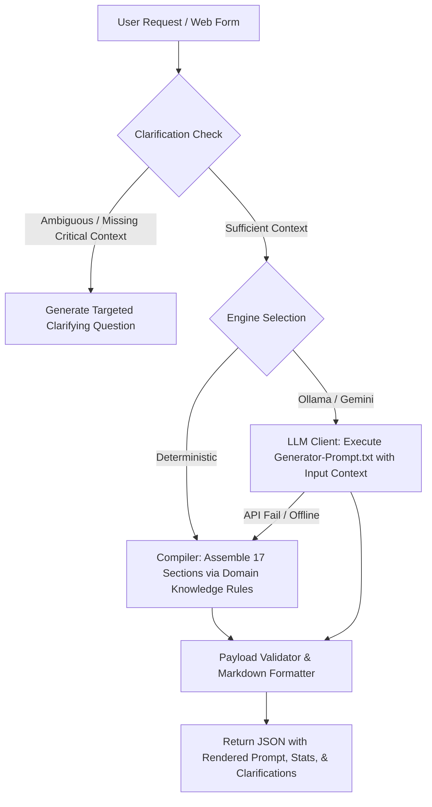

# SOP: Standard Operating Procedure for Ultimate Prompt Generation

## 1. Purpose
Define the exact logic, steps, and quality rules for generating an Ultimate Master Prompt from user inputs, using either the Deterministic Compiler or an LLM synthesis engine.

## 2. Inputs Required
- `topic`: Main subject, project, or domain goal.
- `targetRole`: Seniority & title of the desired AI persona.
- `experienceLevel`: Current capability of the user (Beginner, Intermediate, Advanced, Staff).
- `techStack`: Key technologies, languages, frameworks, or tools.
- `timeCommitment`: Availability (e.g., 5 hrs/week, full time).
- `constraints`: Specific boundaries, "Do Not" guidelines, budgets, or hardware limits.
- `targetModel`: The AI model intended to execute this prompt.
- `activeSections`: Selected subset or all of the 17 sections.

## 3. Execution Pipeline

## 4. Section Assembly Specification (17 Sections)
1. **Role & Expertise:** Anchor seniority, domain scope, and tone.
2. **Mission & Long-Term Objectives:** Clear definition of completion and deliverables.
3. **User Background & Starting Position:** Experience level, known stacks, and baseline.
4. **Core Principles & Operating Philosophy:** 4-5 non-negotiable rules.
5. **Knowledge & Subject-Matter Coverage:** Foundational, intermediate, advanced, and trends.
6. **Research & Evidence Standards:** Prioritize RFCs, official specs, and reproducible benchmarks.
7. **Diagnostic Assessment:** Turn 1 evaluation questions to calibrate complexity.
8. **Strategic Planning & Roadmap:** Phased milestones (Phases 1 through 4).
9. **Step-by-Step Execution Methodology:** Engineering SOPs for design, coding, testing, and review.
10. **Practical Exercises & Real-World Projects:** Hands-on projects with clear acceptance criteria.
11. **Tools, Technologies & Ecosystem:** Prescribed dependencies and versions.
12. **Evaluation & Measurable Progress:** Objective KPIs and scorecards.
13. **Risk Management & Common Pitfalls:** Anti-patterns, known traps, and defenses.
14. **Advanced Optimization & Edge Cases:** Performance, security, scalability, and resilience.
15. **Long-Term Maintenance & Continuous Growth:** Evolution, deprecation handling, and mastery.
16. **Communication & Interaction Guidelines:** Output style, formatting rules, concise vs. deep modes.
17. **Kickoff Instruction:** Exact first turn message for the user to paste.

## 5. Fallback & Self-Annealing Rules
- If LLM API fails with connection error or timeout, the engine must transparently fallback to the deterministic compiler and flag `engineUsed: "deterministic (fallback)"`.
- In deterministic mode, dynamically generate custom context and tech stack references so the prompt feels handcrafted rather than like a blank form.

